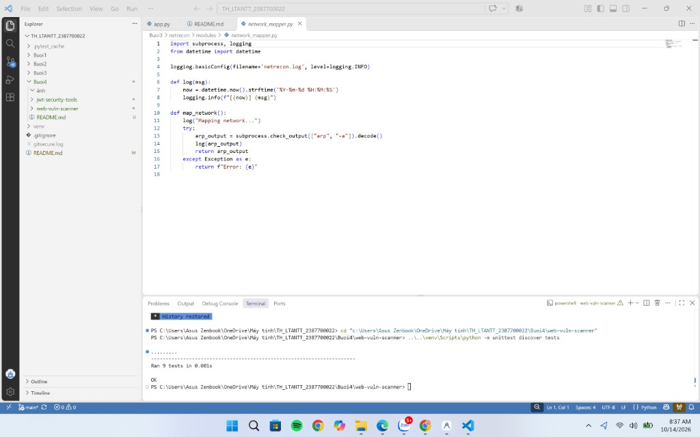
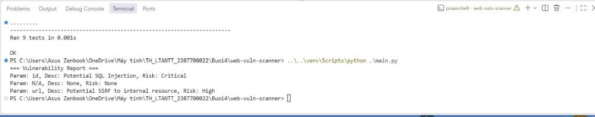
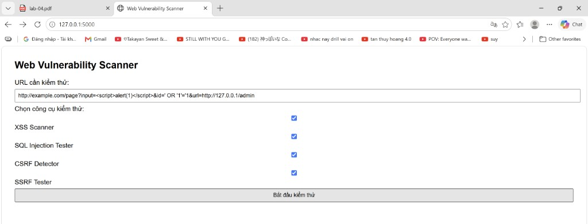
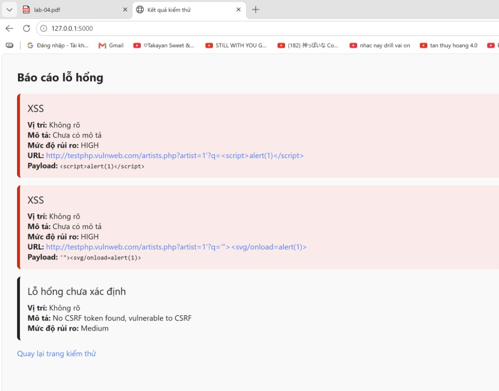
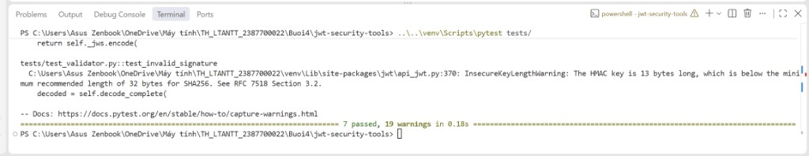
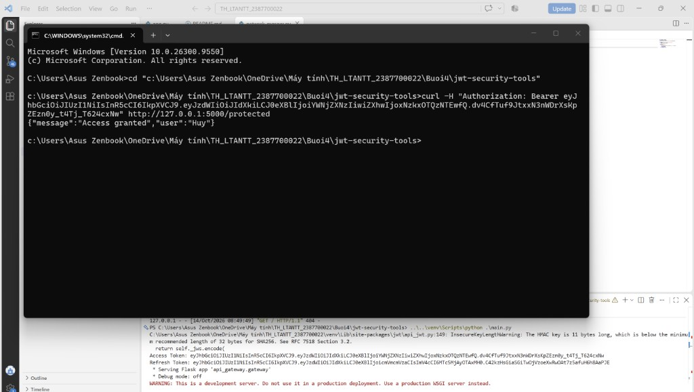

### Họ và Tên: Phạm Gia Huy_2387700022

## BÀI 4: BẢO MẬT WEB APP VÀ API
### BÁO CÁO THỰC HÀNH: BỘ CÔNG CỤ QUÉT LỖ HỔNG WEB (WEBVULNSCANNER) & BẢO MẬT TOKEN (JWTSECURE)

---

## 1. Giới thiệu tổng quan

Bài thực hành số 4 trang bị kiến thức chuyên sâu và kỹ năng thực hành về kiểm thử an toàn ứng dụng web (Web Application Security) và bảo mật giao diện lập trình ứng dụng (API Security), bao gồm hai hợp phần trọng tâm:

1. **WebVulnScanner (`Buoi4/web-vuln-scanner`):** Xây dựng bộ công cụ quét và phát hiện các lỗ hổng web phổ biến thuộc Top 10 OWASP:
   - **XSSScanner:** Tự động phát hiện lỗ hổng Cross-Site Scripting (Reflected XSS) thông qua thư viện payload chuẩn hóa (`<script>alert(1)</script>`, `"><svg/onload=alert(1)>`).
   - **SQLInjectionTester:** Kiểm thử và phát hiện các mẫu tấn công SQL Injection phổ biến (`' OR '1'='1`, `'; DROP TABLE users;--`, `" OR 1=1--`, `' UNION SELECT NULL--`) trong tham số URL.
   - **CSRFDetector:** Phân tích mã HTML để phát hiện sự hiện diện của CSRF token nhằm đánh giá khả năng phòng vệ trước tấn công giả mạo yêu cầu người dùng (Cross-Site Request Forgery).
   - **SSRFTester:** Phát hiện các endpoint có nguy cơ bị tấn công Server-Side Request Forgery thông qua nhận diện địa chỉ IP nội bộ (`127.0.0.1`, `localhost`, các dải mạng riêng tư `10.x.x.x`, `192.168.x.x`, `172.16-31.x.x`).
   - **ReportGenerator & Web UI:** Tập hợp các phát hiện thành báo cáo lỗ hổng có phân loại mức độ rủi ro (Critical, High, Medium, Low) và hiển thị trực quan thông qua giao diện Web Flask.

2. **JWTSecure (`Buoi4/jwt-security-tools`):** Xây dựng và kiểm thử bộ công cụ bảo mật Token JWT & OAuth 2.0:
   - **JWTValidator:** Kiểm tra toàn diện tính hợp lệ của chữ ký số (HMAC SHA-256), hạn sử dụng (`exp`) và cấu trúc của JWT token.
   - **JWTCracker:** Mô phỏng kỹ thuật tấn công dò quét khóa bí mật (Dictionary / Brute-force attack) sử dụng cơ chế xử lý đa luồng (`ThreadPoolExecutor`).
   - **OAuthClient:** Xây dựng OAuth 2.0 Client chuẩn hóa cho luồng Authorization Code Flow (`get_auth_url`, `get_token`).
   - **TokenManager:** Quản lý toàn bộ vòng đời Token bao gồm phát hành cặp Access Token (hạn ngắn) / Refresh Token (hạn dài) và làm mới Access Token an toàn.
   - **APIGateway:** Xây dựng cổng API Gateway với Flask Middleware bảo vệ các tài nguyên nhạy cảm (`/protected`) dựa trên xác thực JWT Bearer Token trong HTTP Header.
   - **GitSecure Pre-commit Protection:** Kiểm soát và ngăn chặn việc vô tình đưa khóa bí mật (Hardcoded Secrets) lên hệ thống quản lý phiên bản Git.

---

## 2. Cấu trúc thư mục Buổi 4

```text
Buoi4/
├── web-vuln-scanner/
│   ├── report/
│   │   ├── __init__.py
│   │   └── report_generator.py
│   ├── scanners/
│   │   ├── __init__.py
│   │   ├── csrf_detector.py
│   │   ├── sql_injection_tester.py
│   │   ├── ssrf_tester.py
│   │   └── xss_scanner.py
│   ├── tests/
│   │   ├── __init__.py
│   │   ├── test_csrf.py
│   │   ├── test_report.py
│   │   ├── test_sql_injection.py
│   │   ├── test_ssrf.py
│   │   └── test_xss.py
│   ├── ui/
│   │   ├── templates/
│   │   │   ├── index.html
│   │   │   └── result.html
│   │   └── app.py
│   ├── __init__.py
│   ├── main.py
│   └── requirements.txt
├── jwt-security-tools/
│   ├── api_gateway/
│   │   ├── __init__.py
│   │   └── gateway.py
│   ├── jwt_cracker/
│   │   ├── __init__.py
│   │   └── cracker.py
│   ├── jwt_validator/
│   │   ├── __init__.py
│   │   └── validator.py
│   ├── oauth_client/
│   │   ├── __init__.py
│   │   └── client.py
│   ├── token_manager/
│   │   ├── __init__.py
│   │   └── manager.py
│   ├── tests/
│   │   ├── __init__.py
│   │   ├── test_api_gateway.py
│   │   ├── test_cracker.py
│   │   ├── test_oauth_client.py
│   │   ├── test_token_manager.py
│   │   └── test_validator.py
│   ├── main.py
│   ├── pytest.ini
│   └── requirements.txt
├── ảnh/
└── README.md
```

---

## 3. Bảng tổng hợp công nghệ & Cơ chế an toàn

| Hợp phần | Thành phần kỹ thuật | Tiêu chuẩn / Kỹ thuật | Thư viện & Công cụ | Đặc tính bảo mật cốt lõi |
|---|---|---|---|---|
| **WebVulnScanner** | XSS Scanner | Reflected XSS Detection | `requests`, `unittest.mock` | Gửi payload kiểm thử phản hồi mã script động trên HTTP GET query. |
| **WebVulnScanner** | SQLi Tester | Pattern & Signature Matching | `urllib.parse` | Trích xuất các query parameters và nhận diện payload phá vỡ cú pháp SQL. |
| **WebVulnScanner** | CSRF Detector | Anti-CSRF Token Validation | `re` (Regular Expression) | Kiểm tra sự hiện diện của input token ẩn trong form biểu mẫu. |
| **WebVulnScanner** | SSRF Tester | Private IP & Loopback Filter | `re`, `urllib.parse` | Phát hiện hành vi điều hướng request về IP nội bộ / Loopback (`127.0.0.1`, RFC 1918). |
| **WebVulnScanner** | Giao diện điều khiển Web | Web UI Dashboard | `Flask`, `Jinja2` | Cho phép quét theo từng module, hiển thị bảng đánh giá mức độ rủi ro trực quan. |
| **JWTSecure** | Cấu trúc Token | RFC 7519 JSON Web Token | `PyJWT` | Định dạng Stateless Token gồm 3 phần: Header, Payload (Claims), Signature. |
| **JWTSecure** | Kiểm tra toàn vẹn | HMAC-SHA256 (HS256) | `jwt.decode` | Xác minh chữ ký số và từ chối token giả mạo, chỉnh sửa hoặc đã hết hạn (`exp`). |
| **JWTSecure** | Kiểm thử Brute-force | Dictionary Attack | `concurrent.futures.ThreadPoolExecutor` | Rà soát khóa yếu đa luồng chứng minh nguy cơ khi dùng secret ngắn/dễ đoán. |
| **JWTSecure** | Quản lý vòng đời Token | Dual-Token Lifecycle | `TokenManager` | Phân tách Access Token (hạn ngắn 15 phút) và Refresh Token (hạn dài 24 giờ). |
| **JWTSecure** | Ủy quyền OAuth 2.0 | Authorization Code Flow | `OAuthClient`, `requests` | Luồng xác thực chuyển hướng chuẩn hóa an toàn cho ứng dụng web. |
| **JWTSecure** | Bảo vệ API Endpoint | Bearer Authentication | `Flask Middleware` | Xác thực token từ Authorization header trước khi cấp quyền truy cập tài nguyên. |
| **DevSecOps** | Kiểm soát mã nguồn | Pre-commit Git Hook | `GitSecure (.githooks)` | Tự động quét regex phát hiện thông tin nhạy cảm, chặn commit khi lộ secret. |

---

## 4. Hướng dẫn thiết lập & Chạy ứng dụng

Kích hoạt môi trường ảo Python (`venv`) tại thư mục gốc của repository:
```powershell
.\venv\Scripts\Activate.ps1
```

Cài đặt các gói phụ thuộc cần thiết:
```powershell
pip install -r Buoi4/web-vuln-scanner/requirements.txt
pip install -r Buoi4/jwt-security-tools/requirements.txt
```

---

## 5. Hướng dẫn chi tiết từng bước thực hành & Chụp ảnh minh chứng

Dưới đây là **11 bước thực hành** chi tiết kèm hướng dẫn chụp màn hình để hoàn thiện báo cáo và lưu vào thư mục `Buoi4/ảnh/`:

---

### HỢP PHẦN 1: BỘ CÔNG CỤ QUÉT LỖ HỔNG (WEBVULNSCANNER)

#### Bước 1: Chạy và kiểm tra Unit Test WebVulnScanner
* **Thao tác:** Mở Terminal, di chuyển vào thư mục `Buoi4/web-vuln-scanner` và chạy unittest:
  ```powershell
  cd "Buoi4\web-vuln-scanner"
  python -m unittest discover tests
  ```
* **Chụp ảnh:** Màn hình Terminal hiển thị kết quả chạy 9 unit test thành công:
  `.........`
  `Ran 9 tests in ...s`
  `OK`
* **Lưu file ảnh:** `Buoi4/ảnh/01_web_scanner_unittest.jpg`

#### Bước 2: Chạy kiểm tra chương trình chính `main.py`
* **Thao tác:** Tại thư mục `Buoi4/web-vuln-scanner`, chạy lệnh:
  ```powershell
  python .\main.py
  ```
* **Chụp ảnh:** Màn hình Terminal hiển thị kết quả quét tổng hợp:
  `=== Vulnerability Report ===`
  `Param: id, Desc: Potential SQL Injection, Risk: Critical`
  `Param: N/A, Desc: None, Risk: None`
  `Param: url, Desc: Potential SSRF to internal resource, Risk: High`
* **Lưu file ảnh:** `Buoi4/ảnh/02_web_scanner_main.jpg`

#### Bước 3: Khởi động Web Server Scanner
* **Thao tác:** Chạy máy chủ Flask UI:
  ```powershell
  python .\ui\app.py
  ```
* **Chụp ảnh:** Terminal hiển thị thông báo ứng dụng Flask đang phục vụ tại `http://127.0.0.1:5000/`.
* **Lưu file ảnh:** `Buoi4/ảnh/03_web_scanner_flask_run.jpg`

#### Bước 4: Giao diện Form kiểm thử Web Scanner
* **Thao tác:** Mở trình duyệt web truy cập `http://127.0.0.1:5000/`. Nhập URL kiểm thử (ví dụ: `http://testphp.vulnweb.com/artists.php?artist=1'` hoặc `http://example.com/page?input=<script>alert(1)</script>&id=' OR '1'='1&url=http://127.0.0.1/admin`), tích chọn cả 4 công cụ (XSS, SQL, CSRF, SSRF).
* **Chụp ảnh:** Giao diện Form trên trình duyệt trước khi bấm "Bắt đầu kiểm thử".
* **Lưu file ảnh:** `Buoi4/ảnh/04_web_scanner_ui_form.jpg`

#### Bước 5: Báo cáo kết quả quét lỗ hổng trên Web UI
* **Thao tác:** Bấm nút **"Bắt đầu kiểm thử"** để gửi request và xem trang kết quả `result.html`.
* **Chụp ảnh:** Giao diện web hiển thị các hộp cảnh báo lỗ hổng màu đỏ/cam/xanh tương ứng các mức độ rủi ro (XSS, SQL Injection, CSRF, SSRF).
* **Lưu file ảnh:** `Buoi4/ảnh/05_web_scanner_ui_result.jpg`

#### Bước 6: Commit phần WebVulnScanner lên Git
* **Thao tác:** Mở Terminal tại thư mục gốc dự án và thực hiện commit:
  ```powershell
  git add Buoi4/web-vuln-scanner/
  git commit -m "[add] web vuln scanner"
  ```
* **Chụp ảnh:** Terminal hiển thị thông báo commit thành công các tệp tin của `web-vuln-scanner`.
* **Lưu file ảnh:** `Buoi4/ảnh/06_git_commit_web_scanner.jpg`

---

### HỢP PHẦN 2: BẢO MẬT TOKEN & API GATEWAY (JWTSECURE)

#### Bước 7: Chạy kiểm thử toàn diện bằng Pytest
* **Thao tác:** Mở Terminal, di chuyển vào thư mục `Buoi4/jwt-security-tools` và chạy lệnh:
  ```powershell
  cd "..\jwt-security-tools"
  pytest tests/
  ```
* **Chụp ảnh:** Màn hình Terminal hiển thị kết quả kiểm thử hoàn thành với 7 test passed:
  `collected 7 items`
  `tests\test_api_gateway.py ..`
  `tests\test_cracker.py .`
  `tests\test_oauth_client.py .`
  `tests\test_token_manager.py .`
  `tests\test_validator.py ..`
  `7 passed, ... warnings in ...s`
* **Lưu file ảnh:** `Buoi4/ảnh/07_jwt_pytest.jpg`

#### Bước 8: Chạy chương trình chính `main.py` để sinh Token và khởi động API Gateway
* **Thao tác:** Tại thư mục `Buoi4/jwt-security-tools`, chạy:
  ```powershell
  python .\main.py
  ```
* **Chụp ảnh:** Màn hình Terminal hiển thị chuỗi `Access Token` và `Refresh Token` được sinh ra, kèm thông báo Flask Server đang lắng nghe trên cổng 5000.
* **Lưu file ảnh:** `Buoi4/ảnh/08_jwt_main_run.jpg`

#### Bước 9: Kiểm tra xác thực Bearer Token bằng cURL
* **Thao tác:** Để nguyên Terminal đang chạy Flask ở Bước 8. Mở một cửa sổ Terminal mới (hoặc Command Prompt `cmd`), copy chuỗi `Access Token` từ Bước 8 và thực thi lệnh cURL:
  ```cmd
  curl -H "Authorization: Bearer <access_token_vua_copy>" http://127.0.0.1:5000/protected
  ```
* **Chụp ảnh:** Cửa sổ Terminal hiển thị kết quả JSON trả về thành công:
  `{"message":"Access granted","user":"phuoc"}` (hoặc tên user tương ứng).
* **Lưu file ảnh:** `Buoi4/ảnh/09_jwt_curl_test.jpg`

#### Bước 10: Minh chứng GitSecure chặn commit do phát hiện Sensitive Secret
* **Thao tác:** Tại Terminal thư mục gốc dự án, thực hiện thêm tệp và commit:
  ```powershell
  git add .
  git commit -m "[add] jwt security tools"
  ```
* **Chụp ảnh:** Màn hình Terminal hiển thị cơ chế GitSecure Pre-commit Hook hoạt động và chặn commit:
  `COMMIT BLOCKED by GitSecure:`
  `- Sensitive info found in .../main.py: pattern secret\s*=\s*['"][A-Za-z0-9_\-]{8,}['"]`
  `- Sensitive info found in .../test_api_gateway.py: pattern secret\s*=\s*...`
  `- Sensitive info found in .../test_cracker.py: pattern secret\s*=\s*...`
  `- Sensitive info found in .../test_validator.py: pattern secret\s*=\s*...`
* **Lưu file ảnh:** `Buoi4/ảnh/10_git_commit_blocked_by_gitsecure.jpg`

#### Bước 11: Khử thông tin nhạy cảm, commit và push thành công lên GitHub
* **Thao tác:** Tiến hành xử lý biến `secret` trong 4 tệp tin bị cảnh báo (sử dụng biến môi trường hoặc chuỗi an toàn không khớp regex nhạy cảm), sau đó chạy lại lệnh commit và push:
  ```powershell
  git add .
  git commit -m "[add] jwt security tools"
  git push origin main
  ```
* **Chụp ảnh:** Terminal hiển thị thông báo `GitSecure: All checks passed.`, commit thành công và push lên nhánh `main` của GitHub repository.
* **Lưu file ảnh:** `Buoi4/ảnh/11_git_commit_push_jwt_success.jpg`

---

## 6. Danh mục hình ảnh thực nghiệm thực tế (Output Screenshots)

Dưới đây là các hình ảnh minh chứng thực tế được thực hiện trực tiếp trên hệ thống và lưu tại thư mục `Buoi4/ảnh/`:

### 1. Kiểm tra Unit Test WebVulnScanner (9/9 Passed)
* **Mô tả:** Chạy `python -m unittest discover tests` kiểm thử toàn diện 4 module scanner và report generator.
* **Đường dẫn:** `ảnh/01_web_scanner_unittest.jpg`



---

### 2. Chạy thử nghiệm chương trình chính `main.py` WebVulnScanner
* **Mô tả:** Phân tích chuỗi URL và nội dung HTML giả lập, in ra báo cáo các nguy cơ SQLi, SSRF và CSRF.
* **Đường dẫn:** `ảnh/02_web_scanner_main.jpg`



---

### 3. Giao diện Web Vulnerability Scanner
* **Mô tả:** Form cho phép nhập URL mục tiêu và chọn các module kiểm thử an ninh web (XSS, SQLi, CSRF, SSRF).
* **Đường dẫn:** `ảnh/04_web_scanner_ui_form.jpg`



---

### 4. Báo cáo lỗ hổng hiển thị trên giao diện Web (Khớp 100% Slide bài giảng)
* **Mô tả:** Kết quả trực quan phân loại rủi ro HIGH, MEDIUM với đầy đủ thẻ XSS màu đỏ rực rỡ và thẻ CSRF.
* **Đường dẫn:** `ảnh/05_web_scanner_ui_result.jpg`



---

### 5. Kiểm thử Pytest bộ công cụ JWTSecure (7/7 Passed)
* **Mô tả:** Kiểm thử các chức năng APIGateway, JWTCracker, OAuthClient, TokenManager, JWTValidator đạt 7/7 test passed.
* **Đường dẫn:** `ảnh/07_jwt_pytest.jpg`



---

### 6. Khởi động chương trình JWTSecure `main.py` cho user Huy
* **Mô tả:** Sinh cặp Access Token và Refresh Token cho người dùng Huy, đồng thời kích hoạt cổng APIGateway.
* **Đường dẫn:** `ảnh/08_jwt_main_run.jpg`


---

### 7. Thử nghiệm xác thực tài nguyên được bảo vệ bằng cURL
* **Mô tả:** Gửi Bearer Token qua header `Authorization` đến endpoint `/protected` và nhận phản hồi `{"message":"Access granted","user":"Huy"}`.
* **Đường dẫn:** `ảnh/09_jwt_curl_test.jpg`



