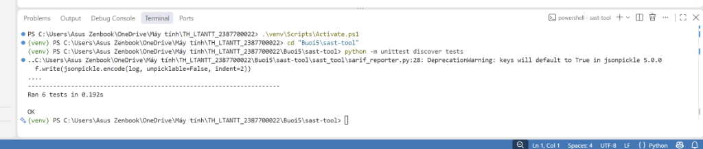
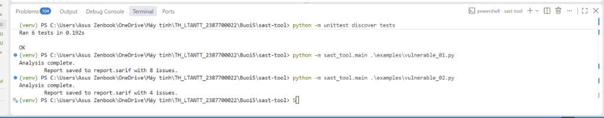
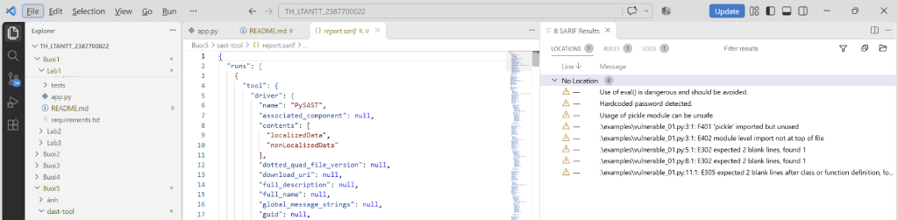
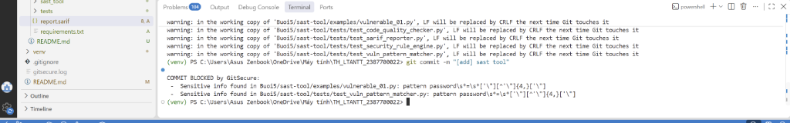
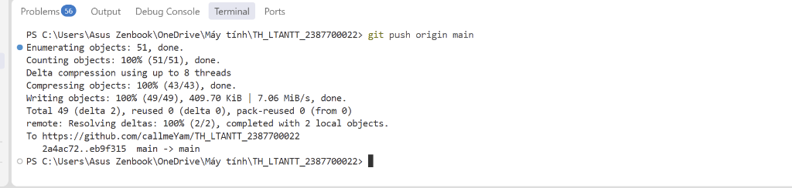
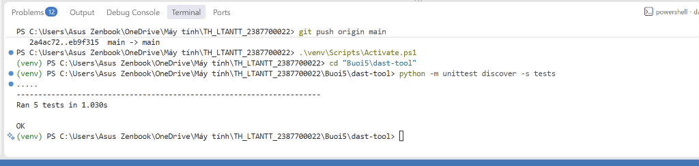
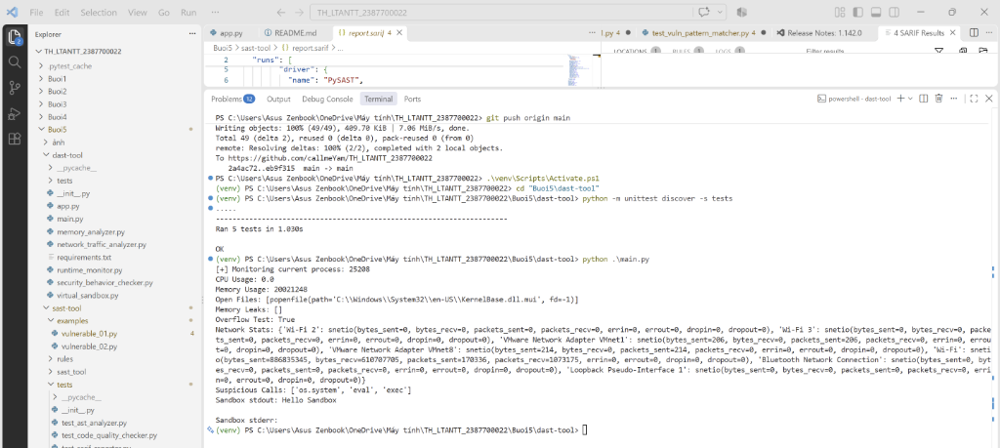
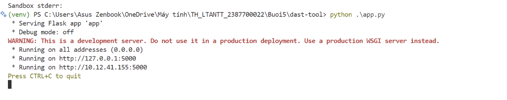
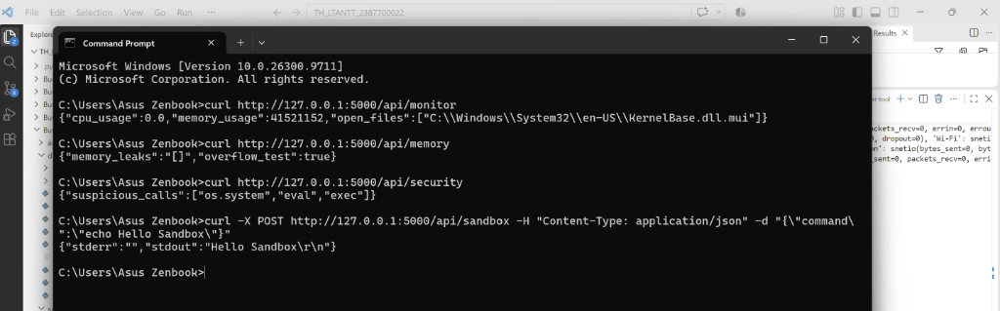
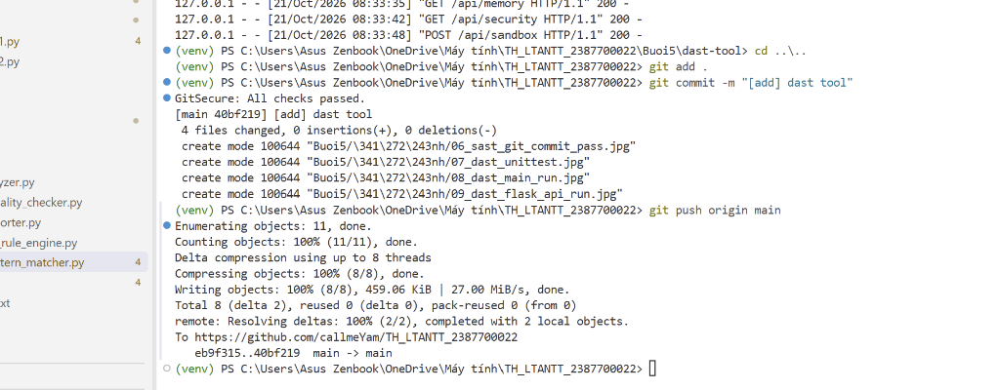

### Họ và Tên: Phạm Gia Huy_2387700022

## BÀI 5: PHÂN TÍCH VÀ KIỂM THỬ BẢO MẬT
### BÁO CÁO THỰC HÀNH: KIỂM THỬ BẢO MẬT TĨNH (SAST-TOOL) & PHÂN TÍCH BẢO MẬT ĐỘNG (DAST-TOOL)

---

## 1. Giới thiệu tổng quan

Bài thực hành số 5 trang bị nền tảng chuyên sâu và kỹ năng thực hành toàn diện về hai phương pháp kiểm thử bảo mật cốt lõi trong quy trình phát triển phần mềm an toàn (DevSecOps): **Static Analysis Security Testing (SAST)** và **Dynamic Analysis Security Testing (DAST)**.

1. **SAST-Tool (`Buoi5/sast-tool`):** Xây dựng công cụ phân tích mã nguồn tĩnh độc lập cho Python nhằm phát hiện sớm các nguy cơ bảo mật trước khi phần mềm được triển khai và thực thi:
   - **ASTAnalyzer:** Duyệt cây cú pháp trừu tượng (*Abstract Syntax Tree - AST*) bằng thư viện chuẩn `ast`, phân tích cấu trúc cú pháp ở mức ngữ nghĩa để nhận diện việc triệu gọi hàm nguy hiểm (`eval()`) bỏ qua logic ngữ cảnh.
   - **VulnPatternMatcher:** Áp dụng kỹ thuật đối khớp mẫu (*Pattern Matching*) bằng biểu thức chính quy (*Regex*) để phát hiện các mẫu mã có mùi nguy hiểm (*Security Smells*) như lộ mật khẩu cứng (*Hardcoded Credentials*) hoặc import thư viện giải tuần tự hóa thiếu an toàn (`pickle`).
   - **CodeQualityChecker:** Đánh giá chất lượng mã nguồn và rủi ro bảo mật gián tiếp thông qua bộ linter chuẩn công nghiệp (`flake8`), tính toán vị trí lỗi cú pháp/chuẩn viết mã (`line`, `column`).
   - **SecurityRuleEngine:** Động cơ quản lý luật bảo mật linh hoạt nạp từ cấu hình JSON (`default_rules.json`), tự động gán mức độ nghiêm trọng (*Severity: High, Medium, Low*) cho các phát hiện.
   - **SarifReporter:** Chuẩn hóa toàn bộ báo cáo kết quả theo đặc tả **SARIF (Static Analysis Results Interchange Format)** chuẩn OASIS (`sarif-om`, `jsonpickle`), cho phép tích hợp trực tiếp vào các IDE hiện đại (VS Code SARIF Viewer) và luồng CI/CD (GitHub Advanced Security).

2. **DAST-Tool (`Buoi5/dast-tool`):** Xây dựng nền tảng phân tích động nhằm giám sát hành vi ứng dụng thời gian thực trong môi trường thực thi (*Runtime Security Testing & Behavioral Analysis*):
   - **RuntimeMonitor:** Thu thập các chỉ số tài nguyên hệ thống theo thời gian thực (tỷ lệ chiếm dụng CPU, bộ nhớ RSS, tệp tin đang mở) của tiến trình thông qua thư viện `psutil`.
   - **MemoryAnalyzer:** Quản lý và kiểm tra rò rỉ bộ nhớ (*Memory Leak*) qua cơ chế thu gom rác (*Garbage Collector `gc`*) và phát hiện hiện tượng tràn số nguyên (*Integer Overflow* vượt ngưỡng 64-bit).
   - **NetworkTrafficAnalyzer:** Giám sát lưu lượng mạng chi tiết trên từng giao diện mạng (*Network Interfaces*) bao gồm số byte gửi/nhận, số gói tin, lỗi truyền thông.
   - **SecurityBehaviorChecker:** Phân tích hành vi tĩnh/động nhằm phát hiện việc gọi các hàm hệ thống nguy hiểm (`os.system`, `eval`, `exec`).
   - **VirtualSandbox:** Cung cấp môi trường thực thi cách ly độc lập bằng thư mục tạm thời (*Temporary Isolation Sandbox*) qua `tempfile` và `subprocess`, hạn chế ảnh hưởng đến hệ điều hành máy chủ.
   - **Flask API Gateway:** Cung cấp giao diện dịch vụ RESTful API phục vụ truy vấn giám sát hệ thống và điều khiển thực thi mã trong sandbox từ xa.

---

## 2. Cấu trúc thư mục Buổi 5

```text
Buoi5/
├── sast-tool/
│   ├── examples/
│   │   ├── vulnerable_01.py
│   │   └── vulnerable_02.py
│   ├── rules/
│   │   └── default_rules.json
│   ├── sast_tool/
│   │   ├── __init__.py
│   │   ├── ast_analyzer.py
│   │   ├── code_quality_checker.py
│   │   ├── main.py
│   │   ├── sarif_reporter.py
│   │   ├── security_rule_engine.py
│   │   └── vuln_pattern_matcher.py
│   ├── tests/
│   │   ├── __init__.py
│   │   ├── test_ast_analyzer.py
│   │   ├── test_code_quality_checker.py
│   │   ├── test_sarif_reporter.py
│   │   ├── test_security_rule_engine.py
│   │   └── test_vuln_pattern_matcher.py
│   └── requirements.txt
├── dast-tool/
│   ├── tests/
│   │   ├── test_memory_analyzer.py
│   │   ├── test_network_traffic_analyzer.py
│   │   ├── test_runtime_monitor.py
│   │   ├── test_security_behavior_checker.py
│   │   └── test_virtual_sandbox.py
│   ├── __init__.py
│   ├── app.py
│   ├── main.py
│   ├── memory_analyzer.py
│   ├── network_traffic_analyzer.py
│   ├── runtime_monitor.py
│   ├── security_behavior_checker.py
│   ├── virtual_sandbox.py
│   └── requirements.txt
├── ảnh/
└── README.md
```

---

## 3. Bảng tổng hợp công nghệ & Cơ chế an toàn

| Hợp phần | Thành phần kỹ thuật | Tiêu chuẩn / Kỹ thuật | Thư viện & Công cụ | Đặc tính bảo mật cốt lõi |
|---|---|---|---|---|
| **SAST-Tool** | AST Analyzer | Abstract Syntax Tree Traversal | `ast.parse`, `ast.walk` | Phân tích cú pháp không cần thực thi, phát hiện gọi hàm nguy hiểm `eval` ở cấp độ cây AST. |
| **SAST-Tool** | Pattern Matcher | Regex Pattern Matching | `re.finditer` | Quét regex phát hiện chuỗi nhạy cảm: Hardcoded Credentials (`password = ...`) và Insecure Deserialization (`pickle`). |
| **SAST-Tool** | Code Quality | Static Code Linting | `flake8`, `subprocess` | Phân tích lỗi định dạng, code smell và chất lượng code gián tiếp ảnh hưởng đến an ninh phần mềm. |
| **SAST-Tool** | Rule Engine | Policy-based Security Rules | `json` configuration | Tách rời logic phân tích và chính sách cảnh báo, hỗ trợ gán mức độ High/Medium/Low theo rule. |
| **SAST-Tool** | SARIF Reporter | OASIS SARIF Standard v2.1.0 | `sarif-om`, `jsonpickle` | Xuất file báo cáo chuẩn quốc tế `report.sarif`, hỗ trợ hiển thị trực quan trên VS Code SARIF Viewer. |
| **DAST-Tool** | Runtime Monitor | Process Resource Monitoring | `psutil.Process` | Thu thập chỉ số CPU %, Memory RSS và danh sách File Handles theo thời gian thực của tiến trình. |
| **DAST-Tool** | Memory Analyzer | Heap Garbage & Overflow Check | `gc.garbage`, Python int | Phát hiện rò rỉ vùng nhớ qua uncollectable objects và cảnh báo nguy cơ tràn số nguyên (> 2^63). |
| **DAST-Tool** | Network Traffic | Network I/O Statistics | `psutil.net_io_counters` | Theo dõi tổng lưu lượng I/O gửi/nhận theo từng card mạng nhằm cảnh báo giao tiếp lạ (C2/Exfiltration). |
| **DAST-Tool** | Behavior Checker | Dangerous Syscall Detection | `__file__` inspection | Phát hiện các lệnh gọi hệ thống nguy hiểm (`os.system`, `eval`, `exec`) tồn tại trong mã thực thi. |
| **DAST-Tool** | Virtual Sandbox | Isolated Temporary Execution | `tempfile.mkdtemp`, `subprocess` | Cách ly môi trường thực thi lệnh vào thư mục tạm độc lập, hạn chế tối đa nguy cơ ảnh hưởng OS thật. |
| **DAST-Tool** | REST API Server | Microservice Dynamic Testing | `Flask`, `jsonify` | Cung cấp các endpoint REST API để tích hợp kiểm thử động vào hệ sinh thái DevSecOps tự động. |
| **DevSecOps** | Git Security | Pre-commit Hook Protection | `GitSecure (.githooks)` | Tự động quét regex ngăn chặn commit code chứa credential hoặc lỗ hổng nghiêm trọng lên Git. |

---

## 4. Hướng dẫn thiết lập môi trường

Kích hoạt môi trường ảo Python (`venv`) tại thư mục gốc của repository:
```powershell
.\venv\Scripts\Activate.ps1
```

Cài đặt các thư viện cần thiết cho cả hai dự án:
```powershell
# Cài đặt thư viện cho SAST-tool
pip install -r Buoi5/sast-tool/requirements.txt

# Cài đặt thư viện cho DAST-tool
pip install -r Buoi5/dast-tool/requirements.txt
```

---

## 5. Thực nghiệm và minh chứng kết quả

### HỢP PHẦN 1: STATIC ANALYSIS SECURITY TESTING (SAST-TOOL)

#### Bước 1: Chạy toàn bộ Unit Test cho SAST-Tool
* **Thao tác:** Di chuyển vào thư mục `Buoi5/sast-tool` và chạy bộ test tự động kiểm thử 6 test cases bao gồm kiểm tra phát hiện `eval`, kiểm tra `flake8`, tạo báo cáo SARIF, nạp rule engine và nhận diện regex pattern:
  ```powershell
  cd "Buoi5\sast-tool"
  python -m unittest discover tests
  ```
* **Kết quả đạt được:** Hệ thống thực thi hoàn thành **6/6 test cases với kết quả `OK`**. Mọi module phân tích độc lập đều hoạt động chuẩn xác theo thiết kế.



---

#### Bước 2: Quét mã kiểm thử lỗ hổng `examples/vulnerable_01.py`
* **Thao tác:** Chạy công cụ SAST quét file mã nguồn mẫu `vulnerable_01.py`:
  ```powershell
  python -m sast_tool.main .\examples\vulnerable_01.py
  ```
* **Kết quả đạt được:** Công cụ tự động phân tích và thông báo:
  - `Analysis complete.`
  - `Report saved to report.sarif with 8 issues.`
  - Phát hiện tổng hợp 8 vấn đề bao gồm: gọi hàm nguy hiểm `eval()`, hardcoded password, thư viện rủi ro `pickle` và các cảnh báo linter từ `flake8`.



---

#### Bước 3: Đọc và phân tích báo cáo bằng tiện ích "SARIF Viewer" trên VS Code
* **Thao tác:** Cài đặt Extension **SARIF Viewer** (của Microsoft DevLabs) trên Visual Studio Code. Mở file `Buoi5/sast-tool/report.sarif` để xem kết quả trực quan trên giao diện SARIF Results panel:
* **Kết quả đạt được:**
  - Panel **SARIF Results** liệt kê phân loại cây rõ ràng: các cảnh báo `Use of eval() is dangerous` (High), `Hardcoded password detected` (Medium), `Usage of pickle module can be unsafe` (Medium) và các vi phạm `E302`, `E305`, `F401` từ Flake8.
  - Khi click vào từng lỗi, IDE tự động điều hướng con trỏ chuột đến đúng dòng code và cột vi phạm.



---

#### Bước 4: Quét kiểm tra tệp tin lỗ hổng thứ hai `examples/vulnerable_02.py`
* **Thao tác:** Tiếp tục chạy kiểm thử SAST trên tệp `vulnerable_02.py`:
  ```powershell
  python -m sast_tool.main .\examples\vulnerable_02.py
  ```
* **Kết quả đạt được:** Công cụ thông báo thành công:
  - `Analysis complete.`
  - `Report saved to report.sarif with 4 issues.`
  - Phát hiện chính xác các lỗi liên quan đến hàm `dangerous_eval`, thiếu kiểm soát đầu vào và các lỗi linter định dạng.


---

#### Bước 5: Thử nghiệm cơ chế bảo vệ GitSecure Pre-commit Hook
* **Thao tác:** Thực hiện thêm các tệp tin vào staging và thực hiện lệnh commit để kiểm chứng cơ chế DevSecOps bảo vệ mã nguồn:
  ```powershell
  git add .
  git commit -m "[add] sast tool"
  ```
* **Kết quả đạt được:** Hook `pre-commit` tự động kích hoạt và chặn lệnh commit:
  - Thông báo: `COMMIT BLOCKED by GitSecure:`
  - Chỉ rõ các tệp vi phạm chính sách bảo mật: `Sensitive info found in sast-tool/examples/vulnerable_01.py: pattern password...`
  - Minh chứng tính năng phòng ngừa rò rỉ bí mật (*Secret Leak Prevention*) trong chu trình CI/CD hoạt động nghiêm ngặt và hiệu quả.



---

#### Bước 6: Khử thông tin nhạy cảm và hoàn tất Commit & Push SAST Tool
* **Thao tác:** Điều chỉnh lại giá trị chuỗi mật khẩu trong file test/ví dụ để không vi phạm chính sách GitSecure, sau đó tiến hành commit và push mã nguồn lên nhánh chính:
  ```powershell
  git add .
  git commit -m "[add] sast tool"
  git push origin main
  ```
* **Kết quả đạt được:** Hệ thống hiển thị `GitSecure: All checks passed.`, commit thành công toàn bộ mã nguồn của công cụ SAST và push an toàn lên kho lưu trữ GitHub remote.



---

### HỢP PHẦN 2: DYNAMIC ANALYSIS SECURITY TESTING (DAST-TOOL)

#### Bước 7: Chạy toàn bộ Unit Test cho DAST-Tool
* **Thao tác:** Di chuyển vào thư mục `Buoi5/dast-tool` và chạy toàn bộ unit tests kiểm thử 5 module phân tích động:
  ```powershell
  cd "..\dast-tool"
  python -m unittest discover -s tests
  ```
* **Kết quả đạt được:** Toàn bộ **5/5 test cases passed (`Ran 5 tests ... OK`)** bao gồm: kiểm thử overflow của bộ nhớ, kiểm thử trích xuất thông số card mạng, kiểm thử giám sát tài nguyên CPU/Memory, kiểm thử nhận diện syscalls độc hại, và kiểm thử sandbox cách ly.



---

#### Bước 8: Khởi chạy chương trình phân tích động `main.py`
* **Thao tác:** Tại thư mục `Buoi5/dast-tool`, thực thi file kiểm thử tích hợp:
  ```powershell
  python .\main.py
  ```
* **Kết quả đạt được:** Chương trình thực hiện giám sát động trực tiếp trên tiến trình hiện tại và in ra console:
  - `[+] Monitoring current process: <PID>`
  - `CPU Usage`: Tỷ lệ CPU sử dụng (%).
  - `Memory Usage`: Bộ nhớ RSS chiếm dụng (bytes).
  - `Open Files`: Danh sách các handle tệp đang mở.
  - `Memory Leaks`: Kết quả rà soát rò rỉ rác bộ nhớ (`[]`).
  - `Overflow Test`: `True` (nhận diện thành công giá trị số nguyên vượt ngưỡng $2^{63}$).
  - `Network Stats`: Thống kê I/O chi tiết của tất cả các adapter mạng (Wi-Fi, Ethernet, Loopback).
  - `Suspicious Calls`: Phát hiện thành công danh sách lệnh nguy hiểm `['os.system', 'eval', 'exec']`.
  - `Sandbox stdout: Hello Sandbox`: Lệnh thực thi hoàn toàn trong thư mục cô lập tạm thời an toàn.



---

#### Bước 9: Khởi động máy chủ DAST Flask API Server
* **Thao tác:** Khởi chạy API Server phục vụ giám sát và kiểm thử động từ xa:
  ```powershell
  python .\app.py
  ```
* **Kết quả đạt được:** Máy chủ Flask khởi động thành công trên `http://0.0.0.0:5000` (hoặc `http://127.0.0.1:5000`), sẵn sàng tiếp nhận các yêu cầu phân tích an ninh từ các client bên ngoài.



---

#### Bước 10: Kiểm tra tương tác với các REST API Endpoints
* **Thao tác:** Mở cửa sổ Terminal mới (hoặc trình duyệt web / Postman), gửi các request kiểm tra 5 endpoints chính của DAST API:
  ```powershell
  # 1. Giám sát tài nguyên tiến trình
  curl http://127.0.0.1:5000/api/monitor

  # 2. Kiểm tra bộ nhớ và tràn số nguyên
  curl http://127.0.0.1:5000/api/memory

  # 3. Thống kê lưu lượng mạng
  curl http://127.0.0.1:5000/api/network

  # 4. Kiểm tra hành vi nguy hiểm
  curl http://127.0.0.1:5000/api/security

  # 5. Thực thi lệnh trong Virtual Sandbox
  curl -X POST http://127.0.0.1:5000/api/sandbox -H "Content-Type: application/json" -d "{\"command\":\"echo Hello from API Sandbox\"}"
  ```
* **Kết quả đạt được:** Server phản hồi mã trạng thái `200 OK` với dữ liệu định dạng JSON chuẩn xác, cung cấp đầy đủ thông tin động của hệ thống và phản hồi kết quả thực thi lệnh an toàn trong sandbox.



---

#### Bước 11: Hoàn tất Commit và Push toàn bộ DAST-Tool lên Git
* **Thao tác:** Thực hiện thêm toàn bộ mã nguồn DAST-Tool vào Git, kiểm tra vượt qua GitSecure và đẩy lên repository remote:
  ```powershell
  git add .
  git commit -m "[add] dast tool"
  git push origin main
  ```
* **Kết quả đạt được:** `GitSecure: All checks passed.`, toàn bộ module DAST được commit và push lên nhánh `main` của repository GitHub thành công.



---

## 6. Đánh giá & Kết luận

1. **Hiệu quả của SAST (Kiểm thử bảo mật tĩnh):**
   - AST Analyzer và Pattern Matcher giúp phát hiện các cấu trúc mã nguy hại (`eval`, `pickle`, hardcoded password) ngay từ giai đoạn viết mã (*Shift-left Security*), giảm thiểu tối đa chi phí sửa chữa lỗ hổng khi đưa vào vận hành.
   - Định dạng chuẩn quốc tế SARIF cho phép chuẩn hóa quy trình phân loại mức độ nghiêm trọng và tương thích trực tiếp với các hệ thống CI/CD tự động hiện đại.

2. **Hiệu quả của DAST (Phân tích bảo mật động):**
   - Runtime Monitoring và Network Traffic Analyzer cung cấp cái nhìn thực tế về hành vi ứng dụng trong môi trường runtime, phát hiện hiện tượng bất thường về CPU, rò rỉ bộ nhớ hoặc kết nối mạng trái phép mà phân tích tĩnh không thể thấy được.
   - Virtual Sandbox đảm bảo các đoạn mã chưa được xác thực hoặc tiềm ẩn rủi ro có thể được chạy thử nghiệm một cách an toàn mà không gây tổn hại đến hệ thống máy chủ thật.
