### Họ và Tên: Phạm Gia Huy_2387700022

## BÀI 6: BẢO MẬT VỚI DEVSECOPS
### BÁO CÁO THỰC HÀNH: TÍCH HỢP BẢO MẬT TRONG CI/CD VÀ TRIỂN KHAI PIPELINE TỰ ĐỘNG TRÊN GITLAB

---

## 1. Giới thiệu tổng quan

Quy trình phát triển phần mềm hiện đại đòi hỏi tốc độ phát hành nhanh đi kèm cơ chế kiểm soát an ninh nghiêm ngặt nhằm ngăn chặn các lỗ hổng phát sinh trước khi mã nguồn được triển khai lên máy chủ sản xuất. Bài thực hành số 6 tập trung nghiên cứu và hiện thực hóa các nguyên lý của DevSecOps thông qua việc xây dựng hệ thống đường ống Continuous Integration and Continuous Deployment (CI/CD) tự động trên nền tảng GitLab. Người thực hiện nắm vững kiến trúc bảo vệ pipeline từ cấp độ kiểm soát truy cập, quản lý biến môi trường bí mật, phân lập runner, thiết lập các chốt kiểm tra an ninh tự động đến triển khai ứng dụng web tĩnh Docusaurus thông qua GitLab Pages.

---

## 2. Cấu trúc thư mục Buổi 6

```text
Buoi6/
├── gitlab-ci-basic/
│   └── .gitlab-ci.yml
├── pipeline-tutorial/
│   ├── blog/
│   ├── docs/
│   ├── src/
│   ├── static/
│   ├── .gitignore
│   ├── .gitlab-ci.yml
│   ├── docusaurus.config.js
│   ├── package.json
│   ├── README.md
│   └── sidebars.js
├── ảnh/
└── README.md
```

---

## 3. Bảng tổng hợp công nghệ và cơ chế an toàn

| Hợp phần | Thành phần kỹ thuật | Tiêu chuẩn hoặc công nghệ | Mục đích triển khai | Đặc tính bảo vệ cốt lõi |
|---|---|---|---|---|
| **GitLab CI** | Pipeline Configuration | YAML format, GitLab CI Engine | Định nghĩa tự động các giai đoạn `build`, `test`, `deploy` | Chuẩn hóa quy trình thực thi mã, ngăn ngừa sai sót thủ công khi triển khai. |
| **GitLab Runner** | Shared / Specific Runners | Docker Executor (Linux Container) | Cách ly môi trường thực thi tác vụ trên container độc lập | Ngăn chặn mã độc xâm nhập hoặc can thiệp trực tiếp vào máy chủ nền tảng. |
| **Artifacts** | Job Artifacts Store | GitLab Storage (`build/`, `public/`) | Truyền chuyển giao sản phẩm đóng gói giữa các giai đoạn | Chỉ chuyển giao tệp tin tĩnh đã biên dịch, loại bỏ rủi ro rò rỉ mã nguồn gốc. |
| **GitLab Pages** | Static Site Hosting | GitLab Pages Engine | Phục vụ trang web tài liệu trực tiếp từ kho lưu trữ Git | Tự động hóa phát hành web tĩnh, tích hợp xác thực HTTPS và kiểm soát truy cập. |
| **DevSecOps** | Security Gates | Access Control, Least Privilege | Phân quyền truy cập và bảo vệ nhánh chính `main` / `master` | Ngăn chặn việc sửa đổi trái phép kịch bản CI/CD và đẩy mã độc trực tiếp. |
| **DevSecOps** | Secrets Management | CI/CD Variables (Masked / Protected) | Ẩn khóa bí mật và mã thông báo khỏi màn hình log | Tránh rò rỉ thông tin đăng nhập và thông tin nhạy cảm ra giao diện điều khiển. |

---

## 4. Yêu cầu tiên quyết và chuẩn bị môi trường

Chuẩn bị các công cụ và tài khoản cần thiết phục vụ bài thực hành:
- Tài khoản định danh trên hệ thống GitLab (`gitlab.com`);
- Môi trường máy trạm cài đặt Git phiên bản 2.x trở lên;
- Nền tảng Node.js phiên bản LTS và trình quản lý gói `npm` phục vụ khởi tạo Docusaurus;
- Môi trường dòng lệnh PowerShell hoặc Bash shell hỗ trợ tương tác Git.

Kiểm tra phiên bản công cụ trên máy cục bộ:
```powershell
node -v
npm -v
git --version
```

---

## 5. Thực nghiệm và minh chứng kết quả

### HỢP PHẦN 1: THIẾT LẬP VÀ THỰC THI PIPELINE CI/CD CƠ BẢN

#### Bước 1: Khởi tạo kho lưu trữ và tạo tệp cấu hình `.gitlab-ci.yml`
- **Thao tác:** Đăng nhập vào GitLab, khởi tạo dự án trống mới có tên `gitlab-ci-basic`. Tại thư mục gốc của kho lưu trữ, tiến hành tạo tệp `.gitlab-ci.yml` định nghĩa 4 jobs (`build-job`, `test-job1`, `test-job2`, `deploy-prod`) phân chia thành 3 giai đoạn:
  ```yaml
  build-job:
    stage: build
    script:
      - echo "Hello, $GITLAB_USER_LOGIN!"

  test-job1:
    stage: test
    script:
      - echo "This job tests something"

  test-job2:
    stage: test
    script:
      - echo "This job tests something, but takes more time than test-job1."
      - echo "After the echo commands complete, it runs the sleep command for 20 seconds"
      - echo "which simulates a test that runs 20 seconds longer than test-job1"
      - sleep 20

  deploy-prod:
    stage: deploy
    script:
      - echo "This job deploys something from the $CI_COMMIT_BRANCH branch."
    environment: production
  ```
- **Kết quả đạt được:** Tệp cấu hình được commit thành công vào kho lưu trữ. Hệ thống GitLab CI/CD tự động nhận diện cấu hình pipeline và kích hoạt trình chạy runner.

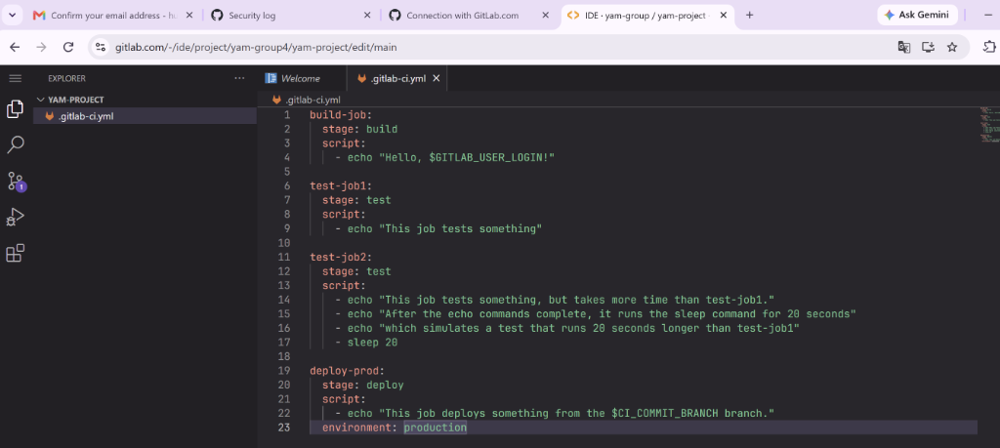

---

#### Bước 2: Theo dõi trạng thái thực thi các giai đoạn của Pipeline
- **Thao tác:** Điều hướng đến mục **Build > Pipelines** trên thanh công cụ quản trị GitLab để quan sát tiến độ thực thi các công việc.
- **Kết quả đạt được:** Danh sách pipeline hiển thị mã định danh commit kèm trạng thái `running` hoặc `passed`. Cả 3 giai đoạn `build`, `test`, `deploy` được biểu diễn trực quan bằng các biểu tượng trạng thái tuần tự.

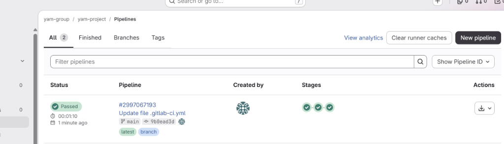

---

#### Bước 3: Quan sát sơ đồ trực quan Pipeline Graph
- **Thao tác:** Bấm chọn vào mã ID của Pipeline đang chạy để mở giao diện sơ đồ đồ thị Pipeline Graph.
- **Kết quả đạt được:** Sơ đồ trực quan phân chia rõ ràng các cột giai đoạn: cột `build` chứa `build-job`, cột `test` chứa song song `test-job1` và `test-job2`, cột `deploy` chứa `deploy-prod`. Trình hiển thị trực quan dấu tích xanh xác nhận các tác vụ đã hoàn thành theo đúng thứ tự thiết kế.

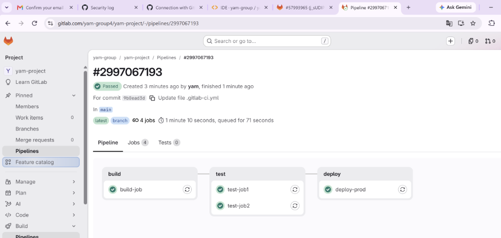

---

#### Bước 4: Kiểm tra chi tiết nhật ký thực thi của Job (Job Log Console)
- **Thao tác:** Nhấp chuột vào tên công việc `deploy-prod` để truy cập màn hình nhật ký terminal thời gian thực của container runner.
- **Kết quả đạt được:** Bảng điều khiển dòng lệnh ghi nhận chi tiết quá trình khởi tạo container Docker, nạp biến môi trường nội tại `$CI_COMMIT_BRANCH`, in ra dòng thông điệp triển khai và kết thúc với trạng thái `Job succeeded`.

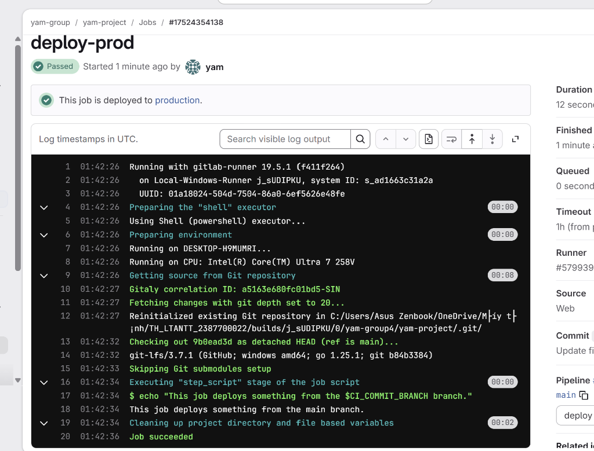

---

### HỢP PHẦN 2: XÂY DỰNG PIPELINE PHỨC TẠP VÀ TRIỂN KHAI VỚI GITLAB PAGES

#### Bước 5: Khởi tạo dự án Docusaurus và cấu hình máy chủ
- **Thao tác:** Tạo dự án mới `pipeline-tutorial` trên GitLab. Thực hiện clone kho lưu trữ về máy tính cá nhân, khởi tạo khung ứng dụng tài liệu Docusaurus và điều chỉnh thông số đường dẫn trong tệp `docusaurus.config.js`:
  ```powershell
  # Sao chép kho lưu trữ về máy cục bộ
  git clone https://gitlab.com/<username>/pipeline-tutorial.git
  cd pipeline-tutorial

  # Khởi tạo khung dự án Docusaurus với mẫu classic
  npx create-docusaurus@latest website classic --javascript

  # Chuyển các tệp tin từ website ra thư mục gốc
  Move-Item -Path "website\*" -Destination ".\" -Force
  Remove-Item -Path "website" -Recurse -Force
  ```
  Tại tệp `docusaurus.config.js`, cập nhật `url` thành `https://<username>.gitlab.io/` và `baseUrl` thành `/pipeline-tutorial/`. Đẩy toàn bộ mã nguồn lên nhánh chính của kho lưu trữ.
- **Kết quả đạt được:** Mã nguồn website tài liệu được đưa lên GitLab thành công, sẵn sàng cho việc đóng gói tự động.

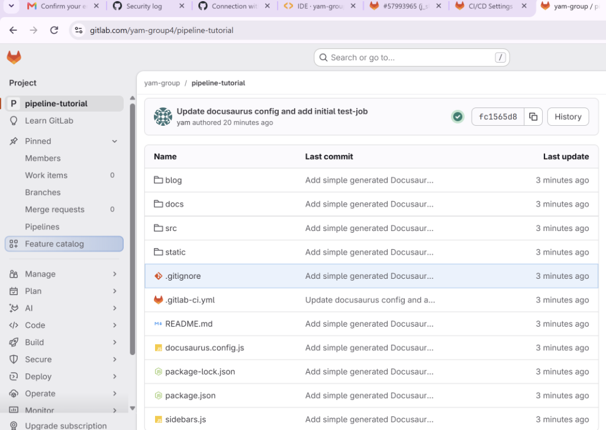

---

#### Bước 6: Khởi chạy Job kiểm thử ban đầu `test-job`
- **Thao tác:** Thiết lập tệp cấu hình `.gitlab-ci.yml` khởi điểm tại thư mục gốc của dự án Docusaurus nhằm kiểm tra tính tương thích của runner:
  ```yaml
  test-job:
    script:
      - echo "This is my first job!"
      - date
  ```
- **Kết quả đạt được:** Pipeline kích hoạt nhanh chóng. Bản ghi log ghi nhận thông điệp xác thực cùng mốc thời gian hệ thống, khẳng định GitLab Runner hoạt động ổn định và sẵn sàng tiếp nhận tác vụ biên dịch.

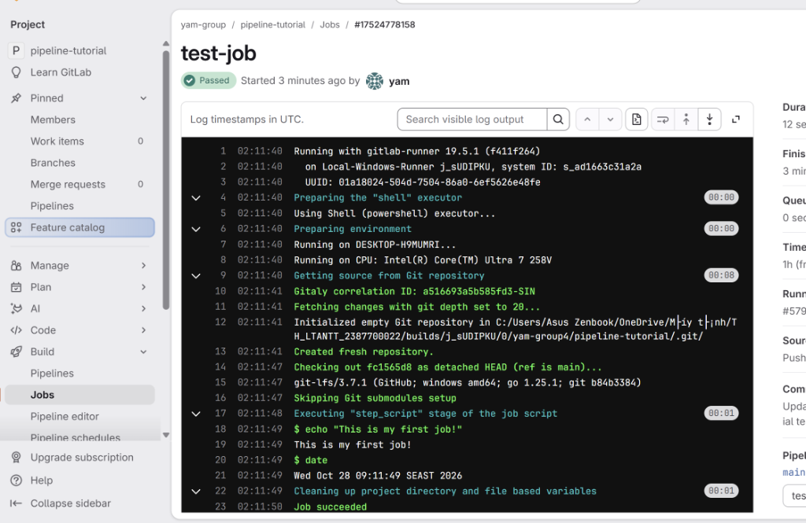

---

#### Bước 7: Tích hợp đóng gói ứng dụng qua Node.js Runner và lưu trữ Artifacts
- **Thao tác:** Cập nhật tệp `.gitlab-ci.yml` thay thế `test-job` bằng `build-job`. Chỉ định container image `node`, thực hiện cài đặt thư viện và xuất sản phẩm tĩnh vào thư mục `build/`:
  ```yaml
  build-job:
    image: node
    script:
      - npm install
      - npm run build
    artifacts:
      paths:
        - "build/"
  ```
- **Kết quả đạt được:** Container Node hoàn tất tải các gói thư viện và biên dịch thành công website Docusaurus. Thư mục `build/` được nén và lưu trữ lại dưới dạng artifacts, cho phép người quản trị tải về hoặc duyệt trực tiếp thông qua nút **Browse** trên giao diện GitLab.

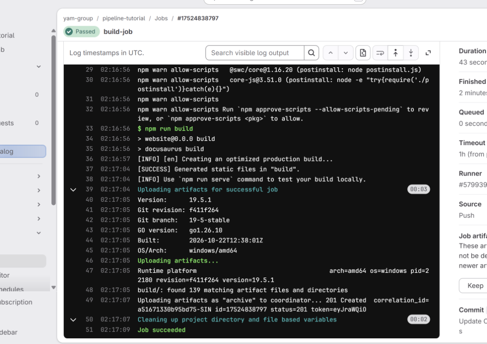

---

#### Bước 8: Hoàn thiện quy trình triển khai tự động hai giai đoạn `build` và `deploy`
- **Thao tác:** Mở rộng cấu hình `.gitlab-ci.yml` với hai giai đoạn `build` và `deploy`. Tích hợp công việc chuyên dụng `pages` để chuyển giao artifacts sang thư mục `public/`:
  ```yaml
  stages:
    - build
    - deploy

  build-job:
    stage: build
    image: node
    script:
      - npm install
      - npm run build
    artifacts:
      paths:
        - "build/"

  pages:
    stage: deploy
    script:
      - mv build/ public/
    artifacts:
      paths:
        - "public/"
  ```
- **Kết quả đạt được:** Quy trình CI/CD thực thi hoàn chỉnh qua cả hai giai đoạn. Sau khi công việc `pages` hoàn tất, GitLab tự động kích hoạt thêm tác vụ nội bộ `pages:deploy` để đưa các tệp tĩnh lên máy chủ GitLab Pages.

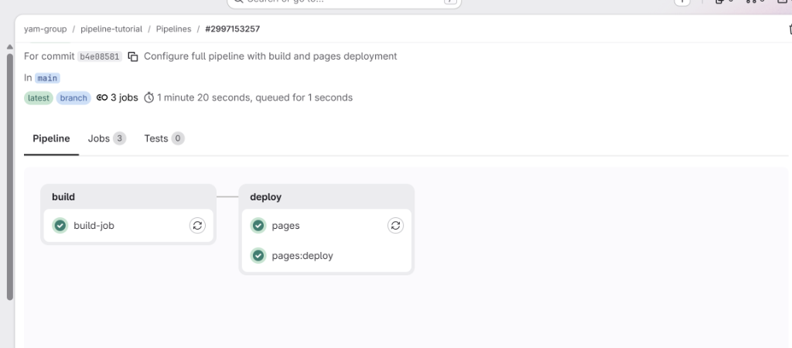

---

#### Bước 9: Thiết lập và xác nhận cấu hình GitLab Pages
- **Thao tác:** Truy cập vào menu điều hướng **Deploy > Pages** trên thanh quản trị dự án GitLab để kiểm tra thông số kích hoạt tên miền và liên kết triển khai.
- **Kết quả đạt được:** Giao diện hiển thị trạng thái phát hành thành công kèm địa chỉ liên kết chính thức có dạng `https://<username>.gitlab.io/pipeline-tutorial/`.

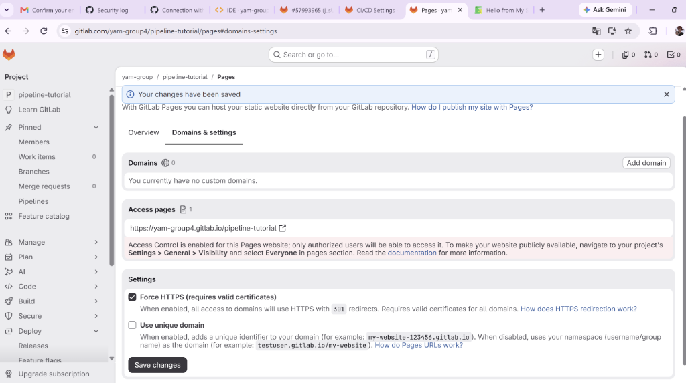

---

#### Bước 10: Kiểm tra hoạt động thực tế của trang web Docusaurus trên Internet
- **Thao tác:** Mở trình duyệt web và truy cập trực tiếp vào đường dẫn GitLab Pages đã được công bố.
- **Kết quả đạt được:** Trang chủ Docusaurus hiển thị đầy đủ giao diện, hình ảnh đồ họa, thanh điều hướng tài liệu và bài viết blog với độ trễ phản hồi thấp và chứng chỉ bảo mật HTTPS hợp lệ.

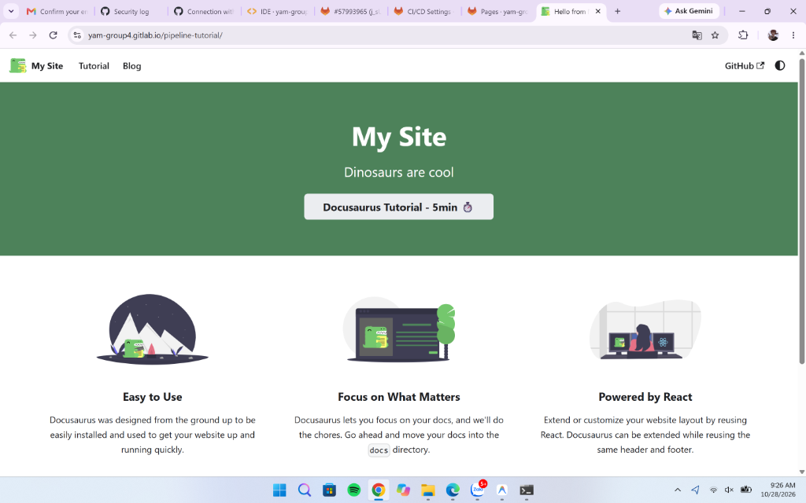

---

#### Bước 11: Đồng bộ hóa toàn bộ mã nguồn Buổi 6 lên GitHub Repository cá nhân
- **Thao tác:** Chuyển về thư mục gốc của repository môn học `TH_LTANTT_2387700022`, tiến hành thêm toàn bộ tệp tin bài làm và ảnh minh chứng của Buổi 6, thực hiện commit kèm thông điệp rõ ràng và push lên GitHub:
  ```powershell
  git status
  git add Buoi6/ README.md
  git commit -m "[add] buoi 6 devsecops and gitlab ci/cd pipeline"
  git push origin main
  ```
- **Kết quả đạt được:** Toàn bộ cấu trúc thư mục `Buoi6/`, tài liệu báo cáo `README.md` cùng các ảnh chụp minh chứng được đẩy lên nhánh chính của kho lưu trữ GitHub thành công và hiển thị đồng bộ.

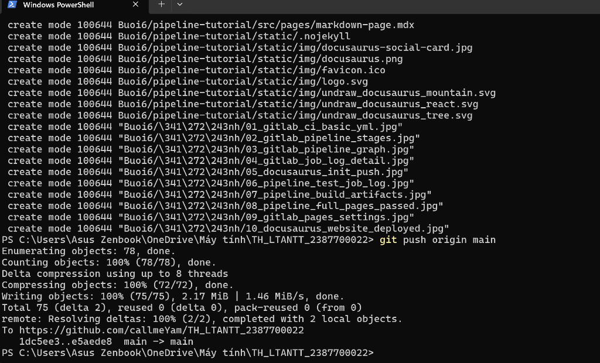

---

## 6. Đánh giá và kết luận

- Tự động hóa kiểm thử và phát hành mã nguồn qua GitLab CI/CD giúp loại bỏ các thao tác thủ công dễ gây lỗi, rút ngắn thời gian phản hồi của chu kỳ phát triển ứng dụng;
- Cơ chế phân lập môi trường bằng Docker container trên GitLab Runner bảo đảm an toàn cho hạ tầng máy chủ chủ quản, ngăn chặn rủi ro rò rỉ hoặc can thiệp chéo giữa các tác vụ;
- Việc tích hợp chốt kiểm tra tự động và chuyển giao artifacts chuẩn xác giữa các giai đoạn đặt nền móng vững chắc cho việc mở rộng thêm các công cụ kiểm thử bảo mật nâng cao như SAST, DAST và kiểm tra sự phụ thuộc mã nguồn trong quy trình DevSecOps toàn diện.
